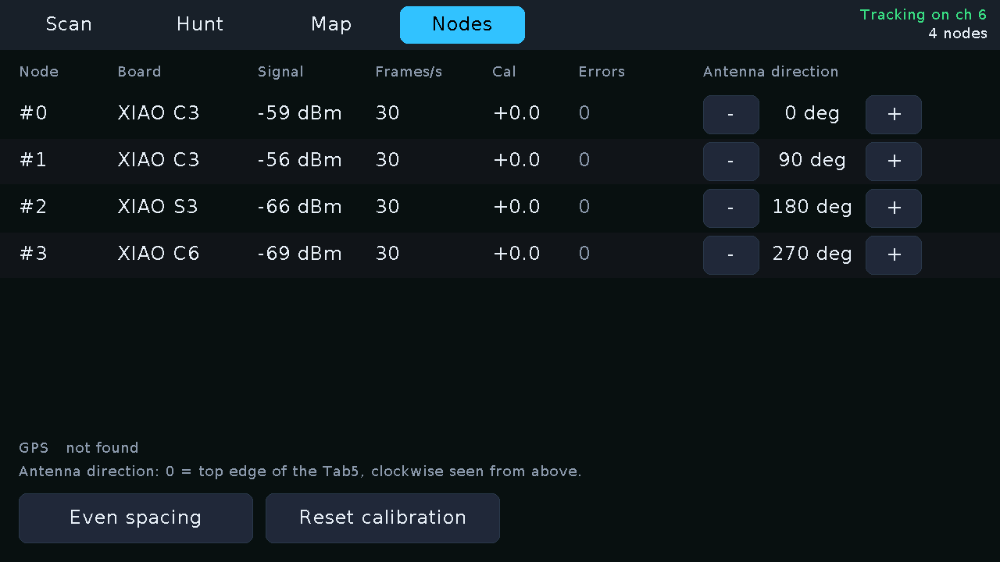
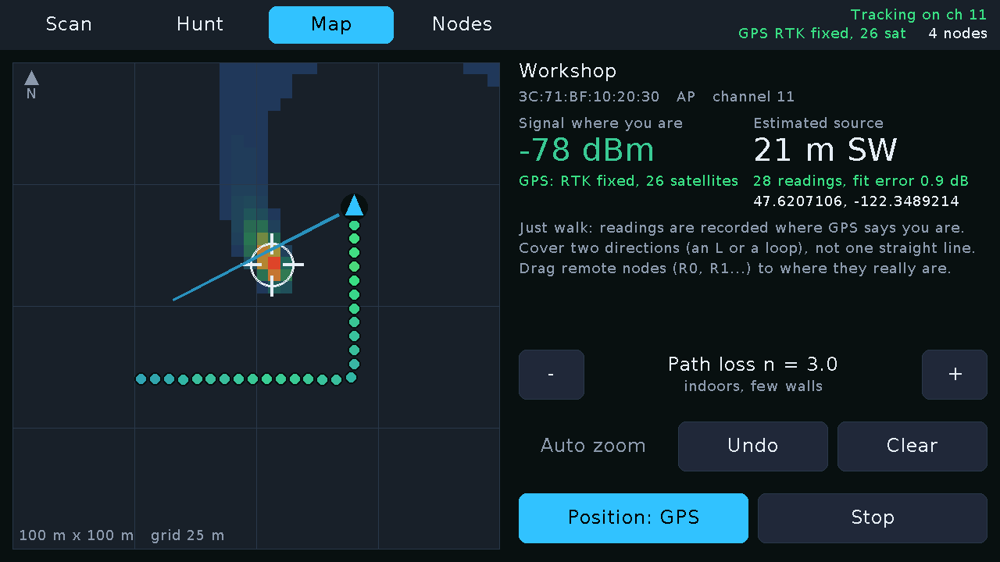
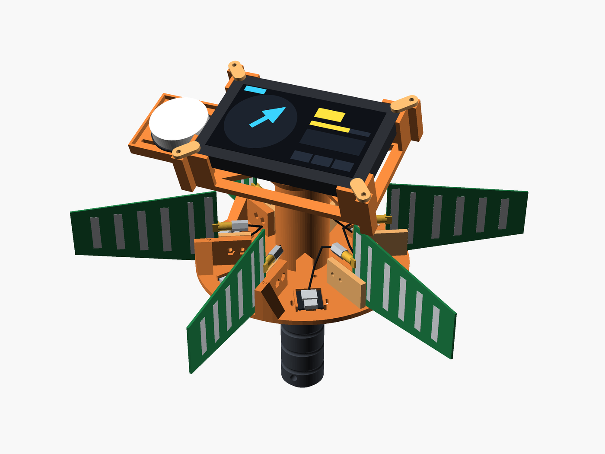

# ESP32 WiFi Source Locator

Find where a WiFi signal is coming from. Several Seeed XIAO ESP32 boards act as
passive receivers, each with a directional antenna pointing a different way. An
M5Stack Tab5 compares what they hear and shows you which way to walk. With a GPS
or RTK receiver attached, it also maps the signal as you walk and gives the
source's estimated coordinates.

| Scan: pick a device | Hunt: follow the arrow |
| --- | --- |
|  |  |
| **Map: estimate a position** | **Nodes: check and set up the hardware** |
|  |  |
| **Map with GPS: just walk** | |
|  | |

(Screenshots are rendered by the PC preview in `tab5/sim`, using simulated signals.)

> **Status: not yet run on real hardware.** All firmware compiles (XIAO C3, S3,
> C6 and Tab5), the locating math, frame parser and GPS parser pass their unit
> tests, and the screens were checked in the PC preview. Expect some bring-up
> work on the bench; see [First power-up](#first-power-up).

Only use this on networks and devices you own or are authorised to investigate.
The nodes only listen: they never join, probe or disturb the networks they hear.

## How it works

- **Scan.** The nodes hop across channels 1-13 and note every transmitter they
  hear: access points (with their names) and client devices (by MAC address).
  The Tab5 merges the lists; tap one to select it.
- **Hunt.** All nodes lock onto the target's channel and report the signal
  strength of every frame it sends. Each antenna "votes" for its own direction,
  weighted by how strongly it hears the target, which gives the bearing arrow.
  The big number, the bar and the click rate rise as you get closer.
- **Map.** The Tab5 fits a distance-vs-signal model to readings taken at
  different places and paints where the source most likely is. With GPS the
  readings are recorded automatically as you walk; without it (or indoors) you
  tap the map where you are standing. Optional battery-powered remote nodes at
  fixed spots add live readings.

It is 2.4 GHz only (none of the C3, S3 or C6 has a 5 GHz radio).

## What you need

| Qty | Part | Notes |
| --- | --- | --- |
| 1 | M5Stack Tab5 | |
| 4-6 | XIAO ESP32-C3, -S3 or -C6 | Any mix. 3 is the minimum, up to 8 are supported. 4 suits wide-beam antennas (patches); 6 suits narrow-beam ones (Yagis). See [Antennas](#antennas). |
| 4 | 2.4 GHz directional antennas with U.FL plugs | See [Antennas](#antennas). This is what makes direction finding work. |
| 1 | Grove hub or a hand-made 4-wire harness | All nodes share the same four wires. |
| 0-8 | Extra XIAOs + USB power banks | Optional remote nodes for Map mode. |
| 0-1 | GPS / GNSS / RTK receiver with a 3.3 V serial output | Optional. See [GPS receiver](#gps-receiver). |

### Antennas

Direction finding relies on each node hearing better in one direction than the
others. With the bare stock antennas there is almost no difference between nodes
and the arrow will stay grey ("No clear direction").

- **Easiest:** small 2.4 GHz patch or panel antennas, one per node, facing outwards.
- **PCB Yagi antennas** (the long boards with a row of stripes) work well but have
  a narrower beam, so four of them leave weak spots between the beams. In
  simulation with a noisy signal, four Yagis lying flat averaged about 22 degrees
  of bearing error (38 in the gaps), against about 10 for six. Two things help:
  - Mount the boards **on edge**, like fins, with the stripes vertical. The beam
    is wider that way round, and it matches the vertical antennas most routers
    use. Four on edge averaged about 13 to 15 degrees.
  - Use **six**, 60 degrees apart.

  Point the end with the short stripes outwards (the connector end is the back)
  and keep that end clear of the Tab5 and of your hands.
- **Cheapest:** keep the stock stick-on antennas and build a cross-shaped
  divider from cardboard covered in aluminium or copper foil, so each antenna
  sits in its own metal-backed corner, about 3 cm from the foil.
- **XIAO C6:** it starts on its built-in ceramic antenna. Build with
  `-DUSE_EXT_ANTENNA` (below) to switch to the U.FL connector.

Mount the antennas around the Tab5 so they point forward (away from the top
edge when held in landscape), right, back and left. Node 0 is forward and the
ids go clockwise seen from above. Other layouts work too: set each node's
direction on the Nodes tab.

### Holder

A 3D-printable holder for the antennas, XIAOs, Tab5 and GPS antenna is in
[`hardware/`](hardware/README.md), with print files and assembly steps.



### Wiring

All wired nodes connect in parallel to the Tab5's **Port A** (the red Grove socket):

| Tab5 Port A | XIAO pin | |
| --- | --- | --- |
| GND | GND | |
| 5V | 5V | |
| G53 (SDA) | D4 (SDA) | |
| G54 (SCL) | D5 (SCL) | |

- If no nodes appear, swap the SDA and SCL wires; cable colours are not
  consistent between brands and swapping them is harmless.
- Keep the cables short (under about 50 cm in total). If the *Errors* column on
  the Nodes tab keeps climbing, add a 4.7 kOhm pull-up resistor from SDA to 3V3
  and another from SCL to 3V3 (any XIAO's 3V3 pin will do).
- A XIAO's 5V pin is wired straight to its USB socket. Unplug a node from the
  harness (or at least its 5V wire) before connecting it to a computer.

### GPS receiver

Any receiver that sends standard NMEA text works: u-blox (ZED-F9P, NEO-M8/M9),
Quectel LC29H, Unicore UM980, and so on. It needs two connections to the Tab5:

| Receiver | Tab5 |
| --- | --- |
| TX (serial out, 3.3 V) | one of the M5-Bus GPIOs listed below |
| GND | GND |

Power the receiver however it normally is. Nothing is ever sent to the
receiver, so its RX pin can stay unconnected.

You do not have to tell the Tab5 which pin or baud rate you used. It watches
these pins for serial traffic, tries the common baud rates (9600 to 921600) and
remembers what worked:

`G38, G7, G16, G17, G6, G37, G3, G4, G2, G48, G47, G35, G51, G45, G52, G18, G19, G5`

The Nodes tab shows how the search is going: *searching...*, *not found* (no
traffic on any of those pins), *G38: no NMEA* (traffic, but not NMEA text), or
*on G38 @ 115200* followed by the fix. If your receiver is on a pin that is not
in the list, or you want to skip the search, set it at build time:

```sh
cd tab5
PLATFORMIO_BUILD_FLAGS="-DGPS_RX_PIN=38 -DGPS_BAUD=115200" pio run -t upload
```

The receiver must output **GGA** sentences (position and fix quality); **RMC**
adds your direction of travel. The fix type is shown as GPS, DGPS, RTK float or
RTK fixed. The Tab5 does not supply RTK corrections: if you want centimetre
fixes, the receiver has to get them over its own link. An uncorrected fix of
about a metre is already finer than signal strength can locate a transmitter.

## Building and flashing

Install [PlatformIO](https://platformio.org/install/cli), then:

```sh
# Each wired node needs its own id, 0 to 7. Pick the environment for the board: c3, s3 or c6.
cd node
PLATFORMIO_BUILD_FLAGS="-DNODE_ID=0" pio run -e c3 -t upload
PLATFORMIO_BUILD_FLAGS="-DNODE_ID=1" pio run -e c3 -t upload
PLATFORMIO_BUILD_FLAGS="-DNODE_ID=2" pio run -e s3 -t upload
PLATFORMIO_BUILD_FLAGS="-DNODE_ID=3 -DUSE_EXT_ANTENNA" pio run -e c6 -t upload

# The Tab5
cd ../tab5
pio run -t upload
```

On Windows PowerShell set the flags with `$env:PLATFORMIO_BUILD_FLAGS="-DNODE_ID=1"` first.

The id is stored on the node, so you can also flash them all identically and
set it afterwards: open `pio device monitor`, type `id 2` and press Enter.
Typing `info` shows the node's id, I2C address and pins.

If the Tab5 will not accept an upload, hold its reset button for about two
seconds until the LED blinks quickly, then try again.

### Optional remote nodes

```sh
cd node
PLATFORMIO_BUILD_FLAGS="-DNODE_ID=0" pio run -e c3_remote -t upload   # shows up as R0
```

A remote node needs only power. It finds the handheld by itself when you start
tracking a target, and appears on the Map and Nodes tabs. Drag it on the map to
where it really is. Remote nodes use ESP-NOW, so in this mode the lowest-numbered
wired node and each remote node send short broadcast packets on the target's channel.

## Using it

1. **Scan** tab: wait a few seconds for the list to fill, filter by access
   points or clients, tap the device you want, then **Hunt** or **Map**.
2. **Hunt:** the first time, tap **Spin cal** and turn once on the spot over about
   12 seconds while holding the Tab5 level. This evens out differences between
   boards and antennas and is remembered. Then follow the arrow, watching that
   the signal number keeps rising. Turn slowly: readings are averaged over about
   half a second.
3. **Map with GPS** (outdoors): just walk. A reading is kept for every spot
   about 1.5 m apart, and standing still or passing again averages more samples
   into it. This also runs while you are on the Hunt tab, so the map is already
   filled in when you switch to it. Walk in two directions (an L or a loop):
   readings along one straight line cannot tell which side the source is on. The
   map is north-up and zooms by itself. It shows the distance and compass
   direction from you to the estimate, plus its latitude and longitude. While
   you are walking, a thin line shows where the Hunt arrow is pointing; it
   assumes you hold the Tab5 facing the way you walk.
4. **Map without GPS** (indoors, or **Position: taps**): choose an **Area** size
   that covers the space, then walk and tap your position at each stop after
   standing still for two seconds. Three readings give a first estimate; eight
   or more, spread out, give a much better one.

On either map, lower **Path loss n** in open space and raise it where there are
many walls. Switching between GPS and taps clears the readings, because the two
use different coordinates.

Good to know:

- **Quiet targets.** A device only shows up while it transmits. Access points
  always do (about ten times a second). An idle phone may say nothing for many
  seconds; the display shows "no signal" until it speaks again.
- **Private MAC addresses.** Phones that are not connected to a network use
  random, changing addresses and cannot be followed. Once connected, the address
  stays fixed for that network.
- **Wrong channel.** A client's channel is a best guess. If Hunt shows no signal,
  step the channel with **-** / **+**, or hunt the access point it talks to.
- **Reflections.** Indoors, signals bounce. Trust the trend over several steps
  more than any single reading, and expect Map results to be good to a few
  metres, not centimetres.

### First power-up

Because this has not run on hardware yet, check these in order:

1. Tab5 shows the Scan screen in landscape. If it says "No sensor nodes found",
   check the wiring notes above and that Port A is supplying 5 V.
2. Nodes tab lists every node with the right board type and *Errors* near zero.
3. Scan fills with your own access point within a few seconds.
4. Hunt your own access point from a few metres away: every antenna should show
   a reading and *Frames/s* should be around 10 or more.
5. Spin cal, then check the arrow follows as you turn.
6. With a GPS receiver: the Nodes tab should show *on G.. @ ...* within about 15
   seconds of power-up, then a fix once the antenna sees the sky.

Four nodes draw roughly 0.4 A from Port A. If nodes reset or drop out, power
them from a separate 5 V supply with the grounds joined.

## Project layout

| Path | What |
| --- | --- |
| `node/` | XIAO firmware: packet sniffer, I2C slave, ESP-NOW relay / remote node |
| `tab5/` | Tab5 firmware: `main.cpp` (hardware), `app.cpp` (logic and screens) |
| `tab5/sim/` | PC preview that renders the screens to image files |
| `hardware/` | 3D-printable holder: OpenSCAD model, STL files, assembly notes |
| `common/` | Shared code: wire protocol, 802.11 frame parser, NMEA parser, locating math |
| `test/` | Unit tests that run on a PC |

```sh
# Unit tests
g++ -std=c++17 -Wall -I common test/test_locate.cpp -o /tmp/test_locate && /tmp/test_locate

# Screen preview (after one `pio run` in tab5/); writes .ppm images to tab5/sim/out
tab5/sim/build.sh
```
