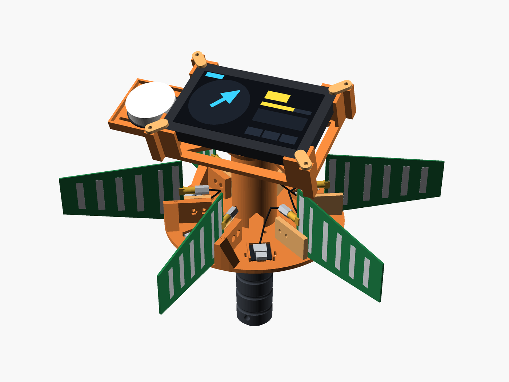
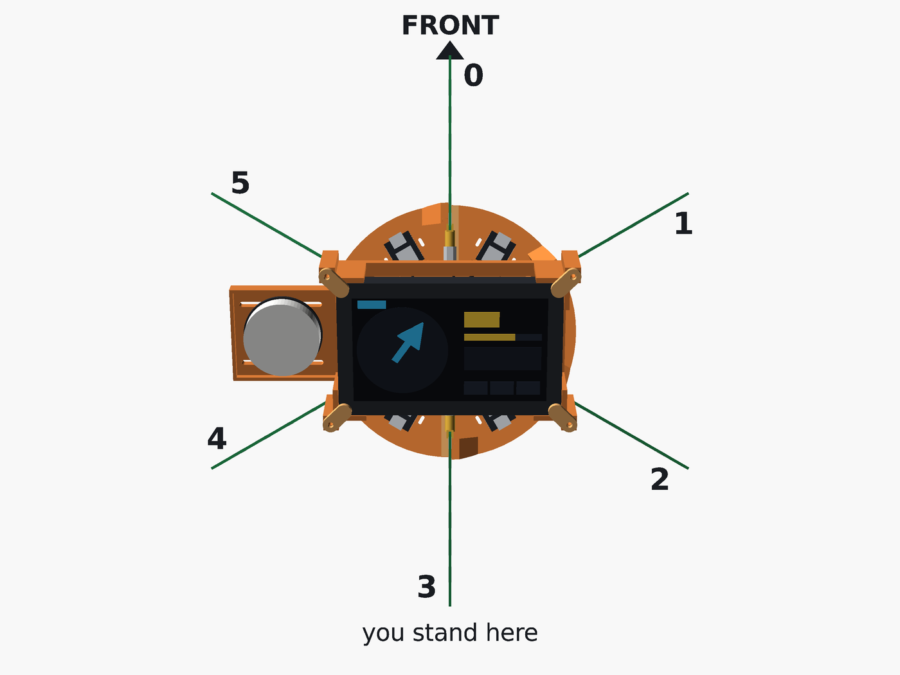
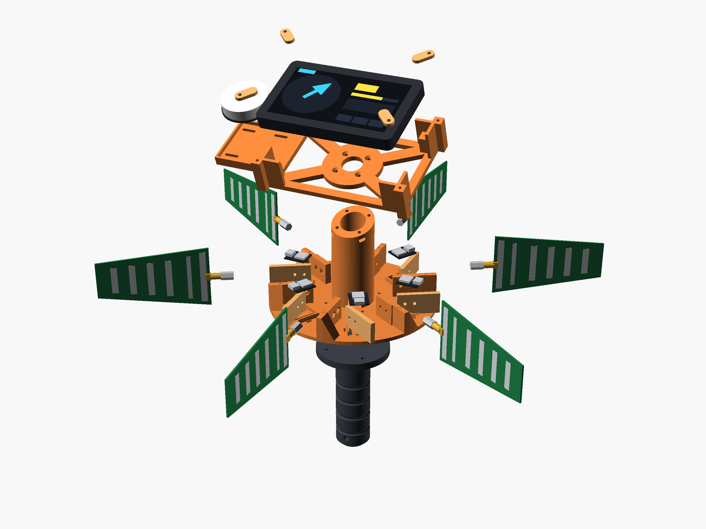

# Printable holder

One handheld unit for the whole locator: six Yagi antenna boards as spokes, six
XIAOs, the Tab5 tilted towards you, a GPS antenna shelf and a pistol grip.

| From above | Exploded |
| --- | --- |
|  |  |

> **Not test-printed, and the antenna board size is an estimate.** The model is
> checked for valid, watertight solids and for collisions between parts, but
> nobody has printed it yet. The antenna dimensions come from a product photo,
> so **measure your boards and set the four `ant_*` values before printing the
> hub.** The Tab5 size (128 x 80 x 12 mm) is from M5Stack's published figures.

## Files

| File | What |
| --- | --- |
| `holder.scad` | The model. Every dimension is a named setting at the top. |
| `stl/*.stl` | Ready-to-slice parts, exported with the default settings. |
| `build.sh` | Re-exports the STL files and the pictures after you change a setting. |

## Before you print: measure

Open `holder.scad` in [OpenSCAD](https://openscad.org) and check these against
your parts. The Customizer panel (Window > Customizer) shows them as fields.

| Setting | Default | Measure |
| --- | --- | --- |
| `ant_len` | 105 | Antenna board, connector edge to tip |
| `ant_w_back` | 60 | Board width at the connector end |
| `ant_w_front` | 36 | Board width at the tip (only affects the pictures) |
| `ant_t` | 1.6 | Board thickness |
| `sma_clear` | 9 | Room needed around the connector and its plug, from the board's centre line |
| `tab_lift` | 16 | Gap behind the tablet. 16 clears the Tab5's battery pack and jumper wires on the back header. |
| `tab_tilt` | 20 | How far the screen leans back towards you, in degrees |
| `corner` | 16 | Length of the tablet corner brackets. Shorten it if one covers a port you need. |
| `gps_shelf`, `gps_w`, `gps_d` | on, 60, 56 | Shelf for the GPS antenna, left of the tablet |

`ant_w_back` and `ant_t` matter most: they set the clamp height and the slot the
board sits in. After changing anything, run `hardware/build.sh stl`, or pick
each part in the `part` setting, press F6, and export it.

## Parts to print

| Part | Qty | Size on the bed (mm) | Notes |
| --- | --- | --- | --- |
| `hub` | 1 | 160 x 160 x 92 | Floor down. Carries the antenna clamps, XIAO bays and the centre column. |
| `clamp` | 6 | 20 x 40 x 4.5 | Flat. |
| `cradle` | 1 | 200 x 99 x 33 | Flat. 141 x 99 with `gps_shelf = false`, for smaller printers. |
| `latch` | 4 | 20 x 9 x 3 | Flat. |
| `handle` | 1 | 72 x 72 x 112 | Flange down, grip pointing up. |

All parts are drawn to print **without supports**. PETG or PLA, 0.2 mm layers,
3 walls, 20 to 30 % infill. Do not use carbon-fibre or metal-filled filament:
it is conductive and will upset the antennas.

## Hardware

| Qty | Item | Where |
| --- | --- | --- |
| 20 | M3 x 12 screw, cap or pan head | 12 for the antenna clamps, 4 for the handle, 4 for the latches |
| 4 | M3 x 12 screw, countersunk | Cradle to column |
| 20 | M3 nut | Clamps (12), handle (4), column (4) |
| 6 | Small cable tie, 2.5 mm wide | One over each XIAO |
| 6 | U.FL to SMA pigtail, 10 to 15 cm | XIAO to antenna |

The latch screws cut their own thread in the plastic; do not overtighten them.

## Assembly

1. **Handle.** Push four nuts into the pockets under the handle's flange. Screw
   down through the hub floor (four holes around the column) into them.
2. **XIAOs.** Each bay sits between two antenna clamps with the USB socket
   facing outwards. Rest the board on the raised pad and tie it down through the
   two small slots. The long slots under the board are for header pins or wires.
3. **Antennas.** Each clamp wall has its number (0 to 5) on top. Push two nuts
   into the hex pockets on the outside of the wall. Stand the board on edge with
   its bottom back corner on the hub floor, its back edge against the step in
   the wall, and the short stripes pointing outwards. Fit a clamp plate on the
   other side and tighten the two screws until the board is firm.
4. **Pigtails.** Connect each XIAO to the antenna clockwise-before it, so the
   XIAO in the bay between antennas 0 and 1 serves antenna 0. Give that XIAO
   node id 0, and so on round.
5. **Wiring.** Run the shared power and I2C wires from the XIAOs through the
   windows at the foot of the column and up inside it.
6. **Cradle.** Slide four nuts into the slots near the top of the column. The
   column top is cut at an angle: the high side is the front. Put the cradle on
   with the GPS shelf to the left (seen from where you stand) and fix it with
   the four countersunk screws.
7. **Tablet.** Bring the wires up through the hole in the cradle, plug them in,
   drop the Tab5 between the corner posts with its top edge towards the front,
   and swing the four latches over its corners.
8. **GPS antenna.** Tie or tape it to the shelf.

Antenna 0 points forwards, away from you, and the numbers go clockwise seen
from above. That matches the firmware's default layout, so the Nodes tab needs
no changes. If you ever take the antennas off, put each one back in the same
slot and run Spin cal again.

## Design notes

- The antenna back edges sit 62 mm from the centre (`r_back`), which keeps
  neighbouring boards about 6 cm apart where they are closest. The whole unit is
  about 334 mm across with the default antenna length.
- The clamps grip only the bottom back corner of each board, below the
  connector, so there is no plastic or metal near the active stripes.
- The tablet sits above the antennas and behind all of them, and your hand is
  below them on the grip.
- The model is drawn for six antennas. Other counts (`n_ant`) are not checked;
  more than six will need a larger `r_back` so the clamps and XIAO bays fit.
